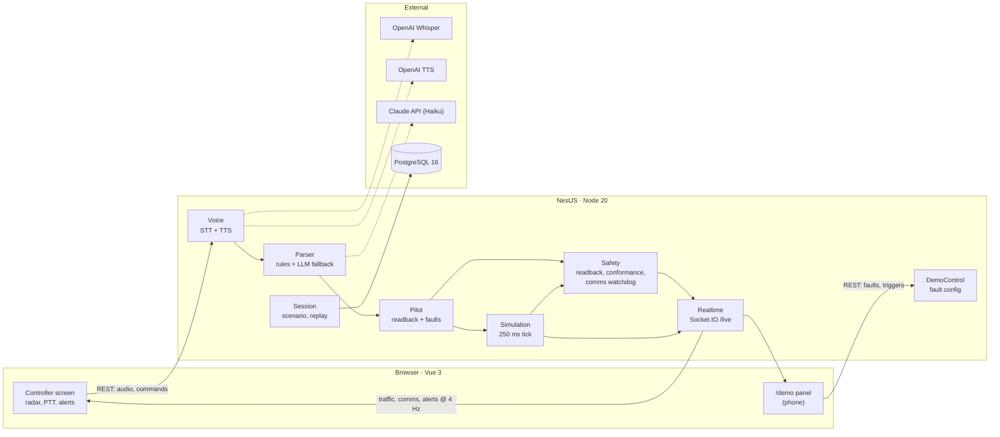

# TowerWhisper

[](https://github.com/ramongen/towerwhisper/actions/workflows/ci.yml)

TowerWhisper is an AI co-pilot for an air traffic controller, built in 24 hours for Craiova
Hackathon v2. The controller speaks into a microphone (push-to-talk); the app transcribes the
instruction, parses it into structured data, plays a simulated pilot readback over a radio-filtered
voice, and raises alerts when the readback does not match, when the aircraft does not do what it was
told, or when nobody has talked to an aircraft for too long. Traffic is simulated around Craiova
airport (LRCV, runway 09/27). AI is only used to understand speech; every safety check is
deterministic TypeScript.

## Architecture



The browser only captures audio and renders state. Simulation, pilot behaviour, faults and alerts
live in the backend. Shared types and event contracts are in `packages/shared`.

## Run it

### Docker (everything, one command)

```bash
git clone <repo> && cd towerwhisper
cp .env.example .env        # optional: add API keys, or leave empty for no-keys mode
docker compose up --build
```

Open <http://localhost:8080> (controller screen) and `http://<laptop-ip>:8080/demo` on a phone
(demo panel). The microphone only works on `localhost` or HTTPS.

### Local development

Requires Node 20 and pnpm 9 (`npm i -g pnpm@9` or `corepack enable`).

```bash
pnpm install
docker compose up -d db             # Postgres only
pnpm --filter shared build          # rebuild after changing shared types
pnpm --filter api start:dev         # NestJS on :3000
pnpm --filter web dev               # Vite on :5173, proxies /api and /socket.io to :3000
```

Checks: `pnpm -r typecheck`, `pnpm -r lint`, `pnpm --filter api test`.

Without `OPENAI_API_KEY` / `ANTHROPIC_API_KEY` the app runs in **no-keys mode**: PTT is replaced by
a text input with the scripted phrases, the pilot voice comes from `apps/api/assets/tts-cache`, and
the LLM parser is disabled. `GET /api/health` reports the active mode.

## Repository layout

```text
apps/web/          Vue 3 SPA — "/" controller screen, "/demo" demo panel
apps/api/          NestJS — one folder per module (session, simulation, voice, parser,
                   pilot, safety, demo, realtime), scenarios/, test/phrases.json
packages/shared/   domain types, WebSocket events, REST bodies, FaultConfig
```

## Team

| Person | Role                 | Owns                                                                              |
| ------ | -------------------- | --------------------------------------------------------------------------------- |
| A      | Voice and parser     | `SttService`, normaliser, rules, `phrases.json`, `CallsignResolver`, `LlmParser`  |
| B      | Simulator and safety | `SimulationService`, Craiova scenario, gateway, `PilotService`, safety checks, DB |
| C      | Main frontend        | `RadarScope`, layout, stores, comms panel, alerts, flight strips, PTT bar         |
| D      | Demo, audio, pitch   | `useRadioVoice`, `TtsService`, `DemoPanel`, `/demo` route, Docker, integration    |

See `CLAUDE.md` for the binding rules and `docs/TowerWhisper-Tech-Spec.pdf` for the full spec.
