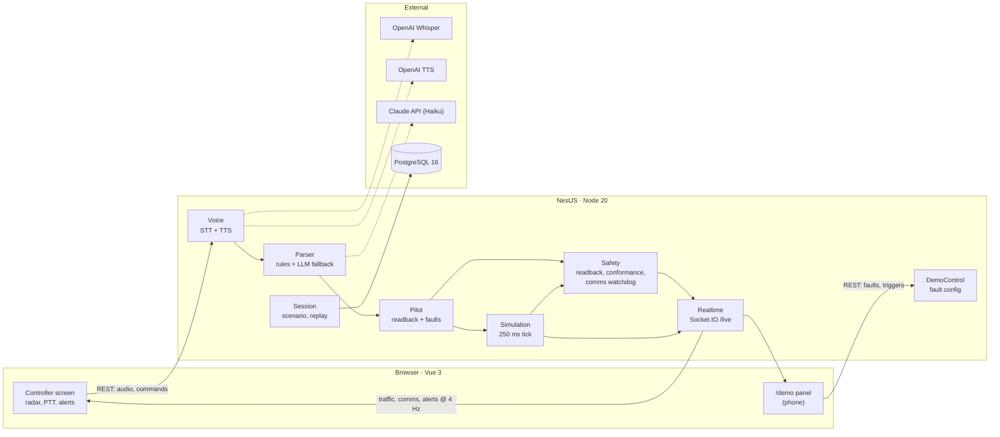

# TowerWhisper

[](https://github.com/ramongen/towerwhisper/actions/workflows/ci.yml)

TowerWhisper is an AI co-pilot for an air traffic controller, built in 24 hours for Craiova
Hackathon v2. The controller speaks into a microphone (push-to-talk); the app transcribes the
instruction, parses it into structured data, plays a simulated pilot readback over a radio-filtered
voice, and raises alerts when the readback does not match, when the aircraft does not do what it was
told, or when nobody has talked to an aircraft for too long. Traffic is simulated around Craiova
airport (LRCV, runway 08/26 with the ILS on 26, real fixes and navaids from AIP Romania). AI is only used to understand speech; every safety check is
deterministic TypeScript.

## Architecture



The browser only captures audio and renders state. Simulation, pilot behaviour, faults and alerts
live in the backend. Shared types and event contracts are in `packages/shared`.

## Run it

### Docker (everything, one command)

```bash
git clone <repo> && cd towerwhisper
cp .env.example .env        # optional: add API keys, or leave empty for no-keys mode
./start.sh                  # macOS / Linux; on Windows: start.cmd (or .\start.ps1)
```

The start script starts Docker Desktop if it is not running, picks the first free port from 8080
(Oracle XE, for example, listens on 8080), builds and starts the stack, waits until it answers and
prints where to go: the console (`http://localhost:<port>`), the demo panel for a phone
(`http://<laptop-ip>:<port>/demo`, no login) and the accounts. Run again, it keeps the same port;
`--logs` (`-Logs` in PowerShell) then follows the logs. Stop with `docker compose down`.

Plain `docker compose up --build` works too, on `WEB_PORT` from `.env` (8080 by default), and the
web container prints the same links in its log; it cannot move to another port by itself, which is
what the scripts are for. The microphone only works on `localhost` or HTTPS.

### Accounts

The first start (empty database) creates two accounts; the login page also offers them in one
click:

| Email                         | Password   | Role       | Lands on                                        |
| ----------------------------- | ---------- | ---------- | ----------------------------------------------- |
| `atc@towerwhisper.app`        | `passpass` | ATC        | the Craiova Approach position (radar, PTT)      |
| `supervisor@towerwhisper.app` | `passpass` | Supervisor | the dashboard: every sector, statistics, replay |

The demo history (below) also creates one controller per other sector, same password:
`atc.bucuresti@`, `atc.timisoara@`, `atc.cluj@` and `atc.oradea@towerwhisper.app`.

Set `AUTH_SECRET` in `.env` (any long random string) outside a local demo; without it a development
secret signs the tokens and the API says so at startup.

### Sectors

Five ROMATSA approach sectors run side by side, each with its own live session (traffic, comms,
alerts, demo faults, recording): **Craiova** (LRCV, the hand-made demo scenario, AIP data),
**București** (LROP, parallel runways 08L/26R and 08R/26L), **Timișoara** (LRTR),
**Cluj** (LRCL) and **Oradea** (LROD). The four new ones get six generated arrivals each along the
airport's real STAR points from AIP ENR 4.4, joining the ILS by themselves about 4 minutes apart;
their runways are derived from published aerodrome data (approximate), and the CF/LB/RB approach
points are simulated. Oradea lies beyond our ENR 4.4 extract (130 NM around Craiova), so its six
entry points (ODSOU, ODSEA, ...) are simulated too. A controller works the sector set on the account and goes straight to it at login.

### Supervisor

- **Overview** — a live card per sector (controller signed in, aircraft, active alerts with their
  reasons, session statistics) with **Watch live** and **Replay**; below, statistics over 1 h /
  24 h / 7 d / 30 d for all sectors or one: alerts raised, resolved by controllers, mean and median
  time to resolve, alert rate per hour of session, alerts over time by severity, how alerts ended,
  time-to-resolve distribution, alerts by type, rate by sector, controllers, latest alerts.
- **Watch live** — the sector's own screen, read-only: radar, aircraft details, weather, comms with
  the pilot voice, alerts. Nothing can be transmitted or resolved; another sector is one click away.
- **Replay** — any recorded session of a sector on a timeline: radar (recorded every 2 s and
  interpolated), transcripts, pilot voice and the controller's own PTT recordings, alerts as they
  were. Play at 1–16×, scrub, or jump with ← / → (voices play at 1× and 2×).
- **Alerts** — every alert ever raised, in every sector, with search and filters (sector, type,
  severity, outcome, period). **Replay** on any alert (here, on the overview's latest alerts, or on
  a live alert in a sector card) opens its session 20 s before it, with the aircraft selected.
  Sessions recorded before radar replay existed replay their transcripts and alerts only.
- **Accounts** — create accounts, switch a role between ATC and Supervisor, set the sector an ATC
  works (an open screen moves at once), set a password, delete.

**Demo history.** So the dashboard has something to show from the first start, the API records
past sessions for București, Timișoara, Cluj and Oradea (Craiova keeps only what is really done in
it): about 20 short sessions per sector over the last 30 days, most of them in the last 24 h. They
are not made up row by row: each one runs the sector's real simulation, pilots, demo faults and
safety checks headless, on simulation time, with a scripted controller who calls every arrival,
clears them to land and reacts to the alerts (resolves some, repeats the instruction). The alerts,
messages and transcripts are therefore exactly what a live session produces; the two most recent
sessions per sector also have radar to replay. It takes about half a minute in the background
after startup, is redone when older than 6 h, and `DEMO_HISTORY=false` turns it off.

The `/demo` panel lists every sector's session with who is signed in; pick the one to drive.

Phones and screens smaller than 1100 × 600 get a "desktop only" page instead of the console
(nothing else is loaded); `/demo` is the exception.

### Demo flow

1. Sign in as `atc@towerwhisper.app`. Select an aircraft on the radar (optional), hold **Space** and say
   _"TAROM 301, descend altitude 4000 feet, turn left heading 080"_.
2. The transcript and the parsed chips appear; ~1.5 s later the pilot reads back over the radio
   filter and the readback check shows **READBACK OK** or raises an alert.
3. Arm a fault on the phone (`/demo`) or on the big screen and transmit again:

| Key | Fault                                               | Expected alert        |
| --- | --------------------------------------------------- | --------------------- |
| 1–5 | wrong altitude / heading / turn / runway / callsign | `HEARBACK_MISMATCH`   |
| 6   | incomplete readback                                 | `READBACK_INCOMPLETE` |
| 7   | no response                                         | `NO_RESPONSE` at 8 s  |
| 8   | turn wrong way                                      | `WRONG_TURN`          |
| 9   | level bust                                          | `LEVEL_BUST`          |

Other keys on the controller screen: **D** demo drawer, **S** results overlay, **R** reset scenario.
The demo panel also ages comms timers (`NO_CONTACT` amber / red, 30/60 min or 15/30 s), spawns a
conflicting BLUE AIR 12 (`CONFLICT_PREDICTED`), steps on the next readback, and sets radio noise and
time speed.

A new alert pops up (CLOSE / SELECT aircraft); in the alert panel, **RESOLVE** (with a
confirmation) moves it to the HISTORY tab, which is kept until a scenario reset.

Landing at LRCV (runway 26, ILS from the east): vector an arrival onto the localizer, e.g.
_"WIZZ 44, descend altitude 4000 feet, turn left heading 240, cleared ILS approach runway two six"_.
It slows down on final and, about 8 NM out, asks _"request landing clearance"_. Answer
_"WIZZ 44, cleared to land runway two six"_ and it lands and leaves the scope; without a clearance
it goes around at 1.5 NM. Aircraft without vectors fly their filed route to TITEK / PEMOK / PANZU
and hold at OZZET.

The scope has three backgrounds (top centre): **CONTOURS**, **TERRAIN** (relief heatmap with spot
heights in feet) and **WX RADAR** (live precipitation in airborne weather-radar colours). Click an
aircraft for its type, weights, flight plan and runway compatibility, and a heading rose around it;
middle-drag pans, the wheel zooms.

Pilot audio for the scripted phrases can be generated once into `apps/api/assets/tts-cache` (then
committed) so the no-keys demo has a voice: `OPENAI_API_KEY=sk-... pnpm --filter api tts:cache`.

### Local development

Requires Node 20 and pnpm 9 (`npm i -g pnpm@9` or `corepack enable`).

```bash
pnpm install
docker compose up -d db             # Postgres only
pnpm --filter shared build          # rebuild after changing shared types
pnpm --filter api start:dev         # NestJS on :3000
pnpm --filter web dev               # Vite on :5173, proxies /api and /socket.io to :3000
```

Checks: `pnpm -r typecheck`, `pnpm -r lint`, `pnpm --filter api test`.

### Local speech-to-text (Whisper, GPU or CPU, nothing to configure)

The `whisper` container (faster-whisper) is part of the stack, so push-to-talk works with no API
key and nothing in `.env`. The start scripts check whether Docker can use an NVIDIA GPU (driver
present and a test container with `--gpus all` runs): if so they add `docker-compose.gpu.yml`
(`large-v3`, float16 on CUDA), otherwise Whisper runs on the CPU (`small.en`, int8, 2-3 s per
call); if the GPU start fails they fall back to the CPU by themselves. The GPU image is big (13 GB
to download, ~30 GB unpacked; the CPU one about 3 GB / 8 GB): the scripts use it only when it is
already there or Docker's disk has ~45 GB free, download it first with retries (an interrupted
download resumes), and take the CPU otherwise. If Docker itself stops during the start (a full
disk does that), they wait for it and try again, and say how much space the disk has left. `-Cpu` / `--cpu` forces the
CPU. Plain `docker compose up` uses the CPU; for the GPU by hand:
`docker compose -f docker-compose.yml -f docker-compose.gpu.yml up --build`.

The model is downloaded into a volume on the first start (CPU ~0.5 GB, GPU ~3 GB); until it is
loaded, typed instructions work and the start script says so. Models: `WHISPER_MODEL` (GPU) and
`WHISPER_CPU_MODEL` (CPU) in `.env`. PTT audio never leaves the laptop; the OpenAI API is only a
fallback when a key is set. The top bar shows the active source (`STT WHISPER LOCAL`,
`STT WHISPER API`, `TEXT MODE`).

With `WHISPER_URL=off` and no `OPENAI_API_KEY` the app runs in **no-keys mode**: PTT is replaced by
a text input with the scripted phrases, the pilot voice comes from `apps/api/assets/tts-cache`, and
the LLM parser is disabled. `GET /api/health` reports the active mode.

## Repository layout

```text
apps/web/          Vue 3 SPA — "/login", "/atc" controller position, "/supervisor" dashboard,
                   live view, replay and accounts, "/demo" demo panel
apps/api/          NestJS — auth/, sectors/ (one SectorRuntime per sector, registry, recording),
                   simulation, voice, parser, pilot, safety, demo, realtime, supervisor,
                   transmissions; scenarios/, test/phrases.json
packages/shared/   domain types, WebSocket events, REST bodies, FaultConfig
```

## Team

| Person | Role                 | Owns                                                                              |
| ------ | -------------------- | --------------------------------------------------------------------------------- |
| A      | Voice and parser     | `SttService`, normaliser, rules, `phrases.json`, `CallsignResolver`, `LlmParser`  |
| B      | Simulator and safety | `SimulationService`, Craiova scenario, gateway, `PilotService`, safety checks, DB |
| C      | Main frontend        | `RadarScope`, layout, stores, comms panel, alerts, flight strips, PTT bar         |
| D      | Demo, audio, pitch   | `useRadioVoice`, `TtsService`, `DemoPanel`, `/demo` route, Docker, integration    |

See `CLAUDE.md` for the binding rules and `docs/TowerWhisper-Tech-Spec.pdf` for the full spec.
