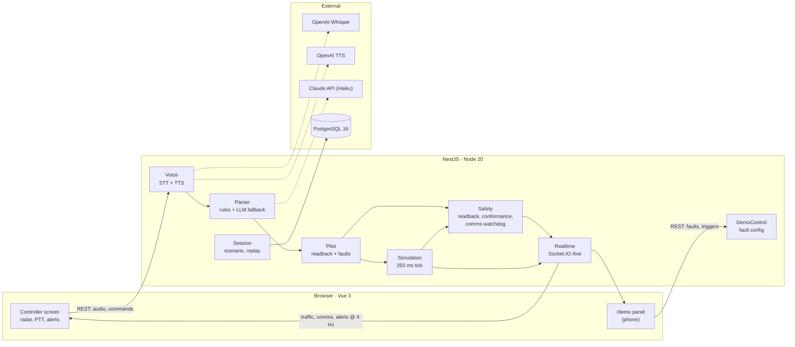

# TowerWhisper

[](https://github.com/ramongen/towerwhisper/actions/workflows/ci.yml)

TowerWhisper is an AI co-pilot for an air traffic controller, built in 24 hours for Craiova
Hackathon v2. The controller speaks into a microphone (push-to-talk); the app transcribes the
instruction, parses it into structured data, plays a simulated pilot readback over a radio-filtered
voice, and raises alerts when the readback does not match, when the aircraft does not do what it was
told, or when nobody has talked to an aircraft for too long. Traffic is simulated around Craiova
airport (LRCV, runway 08/26 with the ILS on 26, real fixes and navaids from AIP Romania). AI is only used to understand speech; every safety check is
deterministic TypeScript.

## Architecture



The browser only captures audio and renders state. Simulation, pilot behaviour, faults and alerts
live in the backend. Shared types and event contracts are in `packages/shared`.

## Run it

### Docker (everything, one command)

```bash
git clone <repo> && cd towerwhisper
cp .env.example .env        # optional: add API keys, or leave empty for no-keys mode
docker compose up --build
```

Open <http://localhost:8080> (controller screen) and `http://<laptop-ip>:8080/demo` on a phone
(demo panel). The microphone only works on `localhost` or HTTPS. If port 8080 is taken (Oracle XE
listens there, for example), set `WEB_PORT=8081` in `.env`.

### Demo flow

1. Select an aircraft on the radar (optional), hold **Space** and say
   _"TAROM 301, descend altitude 4000 feet, turn left heading 080"_.
2. The transcript and the parsed chips appear; ~1.5 s later the pilot reads back over the radio
   filter and the readback check shows **READBACK OK** or raises an alert.
3. Arm a fault on the phone (`/demo`) or on the big screen and transmit again:

| Key | Fault                                               | Expected alert        |
| --- | --------------------------------------------------- | --------------------- |
| 1–5 | wrong altitude / heading / turn / runway / callsign | `HEARBACK_MISMATCH`   |
| 6   | incomplete readback                                 | `READBACK_INCOMPLETE` |
| 7   | no response                                         | `NO_RESPONSE` at 8 s  |
| 8   | turn wrong way                                      | `WRONG_TURN`          |
| 9   | level bust                                          | `LEVEL_BUST`          |

Other keys on the controller screen: **D** demo drawer, **S** results overlay, **R** reset scenario.
The demo panel also ages comms timers (`NO_CONTACT` amber / red, 15/30 min or 15/30 s), spawns a
conflicting BLUE AIR 12 (`CONFLICT_PREDICTED`), steps on the next readback, and sets radio noise and
time speed.

A new alert pops up (CLOSE / SELECT aircraft); in the alert panel, **RESOLVE** (with a
confirmation) moves it to the HISTORY tab, which is kept until a scenario reset.

Landing at LRCV (runway 26, ILS from the east): vector an arrival onto the localizer, e.g.
_"WIZZ 44, descend altitude 4000 feet, turn left heading 240, cleared ILS approach runway two six"_.
It slows down on final and, about 8 NM out, asks _"request landing clearance"_. Answer
_"WIZZ 44, cleared to land runway two six"_ and it lands and leaves the scope; without a clearance
it goes around at 1.5 NM. Aircraft without vectors fly their filed route to TITEK / PEMOK / PANZU
and hold at OZZET.

The scope has three backgrounds (top centre): **CONTOURS**, **TERRAIN** (relief heatmap with spot
heights in feet) and **WX RADAR** (live precipitation in airborne weather-radar colours). Click an
aircraft for its type, weights, flight plan and runway compatibility, and a heading rose around it;
middle-drag pans, the wheel zooms.

Pilot audio for the scripted phrases can be generated once into `apps/api/assets/tts-cache` (then
committed) so the no-keys demo has a voice: `OPENAI_API_KEY=sk-... pnpm --filter api tts:cache`.

### Local development

Requires Node 20 and pnpm 9 (`npm i -g pnpm@9` or `corepack enable`).

```bash
pnpm install
docker compose up -d db             # Postgres only
pnpm --filter shared build          # rebuild after changing shared types
pnpm --filter api start:dev         # NestJS on :3000
pnpm --filter web dev               # Vite on :5173, proxies /api and /socket.io to :3000
```

Checks: `pnpm -r typecheck`, `pnpm -r lint`, `pnpm --filter api test`.

### Local speech-to-text (Whisper large-v3 on your GPU)

With an NVIDIA GPU and Docker Desktop GPU support, put these in `.env` and run
`docker compose up --build`:

```bash
COMPOSE_PROFILES=whisper
WHISPER_URL=http://whisper:9000
WHISPER_MODEL=large-v3          # or large-v3-turbo for even lower latency
```

The `whisper` container (faster-whisper, float16 on CUDA) downloads the model into a volume on the
first start. PTT audio then never leaves the laptop; the OpenAI API is only a fallback when a key
is set. The top bar shows the active source (`STT WHISPER LOCAL`, `STT WHISPER API`, `TEXT MODE`).

Without any speech-to-text (no `WHISPER_URL`, no `OPENAI_API_KEY`) the app runs in **no-keys mode**: PTT is replaced by
a text input with the scripted phrases, the pilot voice comes from `apps/api/assets/tts-cache`, and
the LLM parser is disabled. `GET /api/health` reports the active mode.

## Repository layout

```text
apps/web/          Vue 3 SPA — "/" controller screen, "/demo" demo panel
apps/api/          NestJS — one folder per module (session, simulation, voice, parser,
                   pilot, safety, demo, realtime, transmissions), scenarios/, test/phrases.json
packages/shared/   domain types, WebSocket events, REST bodies, FaultConfig
```

## Team

| Person | Role                 | Owns                                                                              |
| ------ | -------------------- | --------------------------------------------------------------------------------- |
| A      | Voice and parser     | `SttService`, normaliser, rules, `phrases.json`, `CallsignResolver`, `LlmParser`  |
| B      | Simulator and safety | `SimulationService`, Craiova scenario, gateway, `PilotService`, safety checks, DB |
| C      | Main frontend        | `RadarScope`, layout, stores, comms panel, alerts, flight strips, PTT bar         |
| D      | Demo, audio, pitch   | `useRadioVoice`, `TtsService`, `DemoPanel`, `/demo` route, Docker, integration    |

See `CLAUDE.md` for the binding rules and `docs/TowerWhisper-Tech-Spec.pdf` for the full spec.
